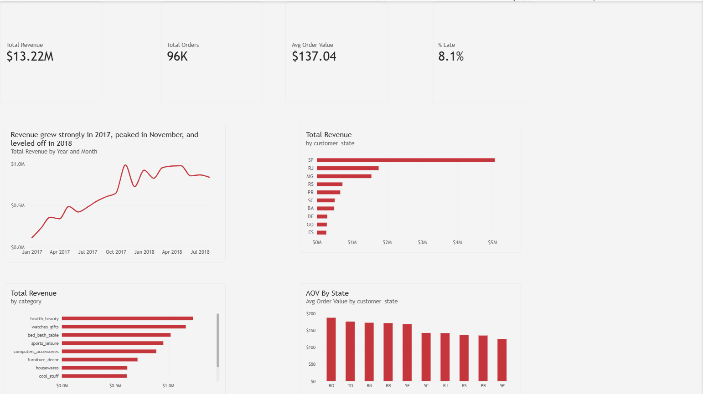

# Olist E-Commerce Analysis (SQL + Power BI)

Analysis of ~100,000 orders from Olist, a Brazilian online marketplace, to
understand what drives revenue and how well orders are delivered.
Data was cleaned and analyzed in MySQL and visualized in Power BI.

## Key Results at a Glance
| Metric | Value |
| --- | --- |
| Total revenue (delivered orders) | R$13.22M |
| Delivered orders | ~96,000 |
| Average order value | R$137.04 |
| Late deliveries | 8.1% |

*Values are in Brazilian reais (BRL). Revenue = item price of delivered orders.*

## Business Questions
1. How did revenue trend over time?
2. Which product categories bring in the most revenue?
3. Which states generate the most revenue?
4. What share of orders are delivered late?
5. How do average order values compare across states?

## Dataset
[Brazilian E-Commerce Public Dataset by Olist](https://www.kaggle.com/datasets/olistbr/brazilian-ecommerce) (Kaggle)
- ~100,000 orders placed from 2016 to 2018
- 8 related tables: orders, customers, order items, products, sellers,
  payments, reviews and category translations

## Tools
- **MySQL 8 (MySQL Workbench):** data loading, cleaning and analysis
- **Power BI:** data model, DAX measures and dashboard

## Process
1. **Loaded the data:** imported 8 CSV files into MySQL with `LOAD DATA`
   and confirmed every table's row count matched the source files.
2. **Checked data quality** before analysis:
   - **Completeness:** missing delivery dates belonged mostly to orders
     that were never delivered; products without a category were
     labeled "unknown."
   - **Uniqueness:** no duplicate keys in orders, customers, products or
     sellers. `review_id` repeated 814 times because one review can cover
     several orders, so review scores were averaged to one per order to
     avoid double-counting.
   - **Business rules:** no order was delivered before it was purchased;
     6 canceled orders had a delivery date and were excluded from sales.
   - **Referential integrity:** used LEFT JOINs to check for orphan
     records between tables.
   - **Fix:** removed a hidden character (byte order mark) that the CSV
     import added to a column name.
3. **Analyzed the data in SQL** using multi-table joins, CTEs, CASE WHEN
   and window functions (LAG, ROW_NUMBER, SUM OVER).
4. **Built clean views for Power BI** (`v_sales`, `v_delivery`) so the
   cleaning rules carry into the dashboard.
5. **Built a Power BI dashboard** with DAX measures for total revenue,
   order count, average order value and late-delivery rate.

## Key Findings
- **Strong growth, then a plateau:** monthly revenue grew steadily through
  2017, peaked in November 2017 (likely Black Friday), and leveled off at
  roughly R$0.85M–1.0M per month in 2018.
- **Top categories:** health & beauty, watches & gifts, and bed, bath &
  table were the top 3 revenue categories.
- **Revenue is concentrated in the Southeast:** São Paulo (SP) generated
  by far the most revenue, followed by Rio de Janeiro (RJ) and
  Minas Gerais (MG).
- **Delivery:** 8.1% of delivered orders arrived after the estimated
  delivery date.

## Recommendations
- Focus marketing and seller recruitment on the top-performing categories.
- Prepare inventory and logistics capacity ahead of November peak demand.
- Investigate delivery performance in states with the highest late rates
  to protect customer satisfaction.

## Project Files
| File | Description |
| --- | --- |
| `sql/01_load_data.sql` | Creates the database and tables, and loads the CSV files |
| `sql/02_data_quality_checks.sql` | Completeness, uniqueness, business-rule and orphan checks, plus a cleaning log |
| `sql/03_business_questions.sql` | SQL queries answering the business questions |
| `Olist_Dashboard.pbix` | Power BI dashboard file |
| `sales_overview.png` | Dashboard screenshot |

## Author
**Dongqin Lin** · [GitHub](https://github.com/donglin1994-cmd)
